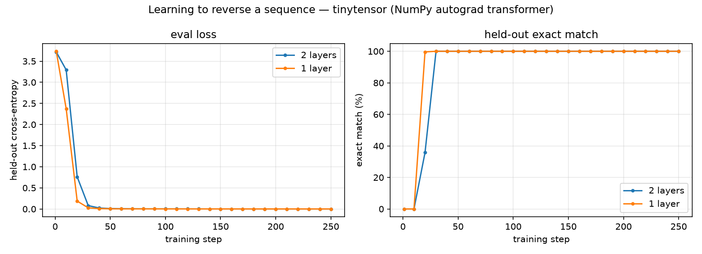

# tinytensor: a transformer that learns to reverse, with every gradient hand-written

A decoder-only transformer and a reverse-mode automatic differentiation engine,
implemented from scratch in NumPy (float64, CPU-only, no ML frameworks). Trained
on a sequence-reversal task that structurally **requires** order-sensitive
attention. **100% exact match on 512 held-out sequences**, against a 15.1%
position-free baseline — with 20 finite-difference gradient checks, a
memory-regression test suite, and a documented debugging log.

Built to answer one interview question convincingly: *do you actually understand
what happens inside the framework, or do you only know how to call it?*

## Results

All numbers are measured, on sequences the model never saw (different RNG seed
from training). Reproduce with the commands in [Reproducing the results](#reproducing-the-results).

| Model | Params | Order info? | Held-out token acc | Held-out exact match |
|---|---|---|---|---|
| TinyGPT, 1 layer × 4 heads | 53K | yes | **100.0%** | **100.0%** (512/512) |
| TinyGPT, 2 layers × 4 heads | 106K | yes | **100.0%** | **100.0%** (512/512) |
| Bag-of-tokens MLP (ablation) | 393K | **no — by construction** | 15.1% | 0.0% |

The ablation is the point. The bag-of-tokens model sees the same multiset of
tokens for every permutation of a sequence, so it *cannot* use order; its optimal
strategy is to guess the most frequent bag token at every position, which scores
E[max_v count(v)]/L ≈ 15%. It hits exactly that ceiling, 0% exact match. Same
engine, same loss, same data — the only variable is whether the model can attend
across positions. The 0% → 100% gap is what attention buys.



The transformer shows a phase transition: 3.9% → 94% token accuracy between
training steps 10 and 20, 100% exact match by step 30 (~15 s of CPU time).
A single attention layer suffices for reversal and converges faster than two —
depth is not free even at this scale.

## Why sequence reversal

Reversal is a minimal probe of order sensitivity:

- **It is impossible without position/attention.** Proven by the ablation above.
- **It is impossible for a causal model reading left-to-right** — the token that
  belongs at output position *i* sits at input position *L−1−i*, which the causal
  mask hides for every *i < L/2*. The model must *use* attention to look back.
- **It has an unambiguous metric.** Exact match over the whole sequence: no
  judgement calls, no cherry-picking. A model at 51% is not "halfway good".

### The causal-mask trap (a real bug we hit, and the fix)

The first version fed the model `[x1 … xL]` and asked for `[xL … x1]` as targets
aligned position-by-position. It converged instantly to a suspicious plateau:
**51.4% token accuracy, 0% exact match, and every prediction was correct on the
second half of the output and constant on the first half.** That is not
undertraining — it is the mask. Output position *i* can never see input position
*L−1−i* for *i < L/2*, so no amount of training fixes the first half. The standard
fix (used in copy/induction-head benchmarks) is to show the sequence twice:

```
input  = [x1 x2 … xL  x1 x2 … xL]
target = [ 0  0 …  0  xL … x2 x1]     # first half pad/ignored in the loss
```

The model reads the first copy and writes the reversal over the second copy. Now
every answer position can causally see the token it needs, and the task still
requires genuine attention. See `tinytensor/data.py` and the "causal mask" entry
in `notes.md`.

## What is implemented

**`tinytensor/engine.py`** — reverse-mode autograd over NumPy:

- ops: add/sub/mul/div/pow, matmul (batched), exp/log/tanh/relu, reshape/transpose/sum/mean
- numerically stable softmax / log-softmax / cross-entropy (max-shift treated as a
  constant, which is exact and gradient-free)
- gradient accumulation into `.grad` (correct fan-out), broadcasting-aware
  backward via `_unbroadcast`
- iterative topological sort — no recursion limit, works on graphs >1000 ops deep
- graph freeing after backward (`retain_graph=False`), matching PyTorch's default

**`tinytensor/nn.py`** — pre-LayerNorm GPT-style block: token + position
embeddings, causal multi-head self-attention (additive mask), MLP, residual
connections, final LayerNorm + LM head. Every layer's input gradient is verified
by finite differences, including the full attention block.

**`tinytensor/optim.py`** — Adam with bias correction, SGD with momentum,
global-norm gradient clipping.

**Tests (27, all passing)** — `tests/test_engine.py` verifies every op against
central finite differences (float64 + h=1e-6 ⇒ ~7 significant digits; a pass
under 1e-6 relative error is a real pass, not a generous one), plus behavioural
tests: softmax stability at logits ≈ 1000, causality (perturbing a *future* token
must not change *past* outputs), gradient fan-out, and `tests/test_memory.py`,
which pins the leak fixes described in the debugging log.

## The debugging log (the part interviewers probe)

Two failures were found and fixed during development; both are encoded as
regression tests, and neither was guessable from the loss curve alone.

1. **~9 MB/step memory leak → OOM-kill at batch 64.** Resident memory grew
   ~35 MB/step at batch 64 (measured via `/proc/self/status`), and the process
   was killed by the OOM killer at step ~40. Root cause: two reference cycles.
   Each op's backward rule was a closure capturing **its own output tensor**
   (`out → _backward → closure → out`), and the recursive topological sort was a
   closure referencing **itself** for recursion, which also captured the `topo`
   list holding every graph tensor. Python's generational GC reclaims cycles only
   on collections that rarely ran in this workload. Fix: backward rules take the
   output as an argument (`_bw(out)`), and the toposort is iterative. Verified:
   0 live graph tensors after 50 engine-only steps and 60 full training steps
   with `gc` observed but never forced.

2. **The causal-mask plateau at 51.4%.** Not a code bug — a task-design error.
   The model had learned exactly the half of the problem the mask permitted, and
   the loss curve looked like a clean convergence. The diagnosis was reading the
   per-position predictions (constant first half), then proving the information
   was causally unavailable. Fix: repeated-input task design, `ignore_index` in
   the loss so only the scored half contributes.

3. *(Bonus)* the iterative-DFS rewrite then introduced a **toposort ordering
   bug**: marking nodes "seen" at push time instead of expansion time breaks
   post-order for shared subgraphs (the softmax diamond). The finite-difference
   gradient tests caught it within one test run. Two lessons: gradient checks are
   not decoration, and "obviously equivalent" graph traversals are not.

## Reproducing the results

```bash
python -m venv .venv && source .venv/bin/activate
pip install -r requirements.txt

pytest                      # 27 tests: gradient checks, causality, memory, e2e
pytest -m "not slow"        # same suite without the 15 s end-to-end test

# main run — 100% exact match, ~1 min on 4 vCPU
python scripts/train_reverse.py --steps 250 --eval-every 10

# ablation — position-free baseline, lands at its 15% ceiling
python scripts/baseline_bag.py --steps 300

# 1-layer variant + learning-curve figure
python scripts/train_reverse.py --steps 250 --eval-every 10 --layers 1 \
    --out results/history_1layer.json
python scripts/plot_curve.py --hist results/history.json --hist results/history_1layer.json \
    --labels "2 layers" --labels "1 layer" --out results/learning_curve.png
```

Determinism: every script is seeded (`numpy.random.default_rng(seed)`); a re-run
reproduces the numbers in the table exactly on the same NumPy version.

Requires Python ≥ 3.10, NumPy, matplotlib (plot only), pytest. No GPU, no torch.

## Project structure

```
tinytensor/
  engine.py        autograd engine (ops, backward, iterative toposort, graph freeing)
  nn.py            Linear / LayerNorm / Embedding / MLP / CausalSelfAttention / TinyGPT
  optim.py         Adam, SGD+momentum, gradient clipping
  data.py          repeated-input reversal task (with the "why" documented)
  utils.py         seeding, metrics (pad-aware), timing
scripts/
  train_reverse.py training + held-out eval + JSON history
  baseline_bag.py  position-free ablation
  plot_curve.py    learning-curve figure
tests/
  test_engine.py           20 finite-difference & behavioural checks
  test_memory.py           3 leak/regression tests
  test_task_and_training.py 4 task-shape & end-to-end tests
results/                    measured JSON histories + figure (committed)
notes.md                    dated build log: decisions, failures, fixes
```

## Scope and limitations (stated, not hidden)

- **Scale.** ~100K params, context 32. The claims here are about *correctness and
  understanding*, not scale; nothing in the design assumes small scale, but only
  small scale was measured.
- **Speed.** float64 NumPy is ~50–100× slower than a float32 BLAS/torch
  equivalent. float64 was chosen so finite-difference gradient checks are
  meaningful — that is the point of the repo.
- **Memory, not compute, optimised.** There is no fused QKV, no FlashAttention,
  no activation checkpointing. Embedding lookup is `one_hot @ W`, which is
  O(vocab) memory per position rather than O(1) — fine at vocab 32, wrong at
  50K, and the trade-off is documented in `nn.py`.
- **Coverage.** Only the ops this model needs are implemented; each one is
  verified. Dropout and AdamW are not (yet) implemented.
- **The task is synthetic.** Reversal proves order-sensitivity, not language
  ability. It is the machine-learning equivalent of a unit test, not a benchmark.

## Author

Michael Koe — Nairobi, Kenya · [GitHub](https://github.com/koe-michael) ·
[LinkedIn](https://www.linkedin.com/in/michael-koe)

Part of an 8-week ML engineering portfolio plan; see also the planned follow-ups
in `notes.md`.
